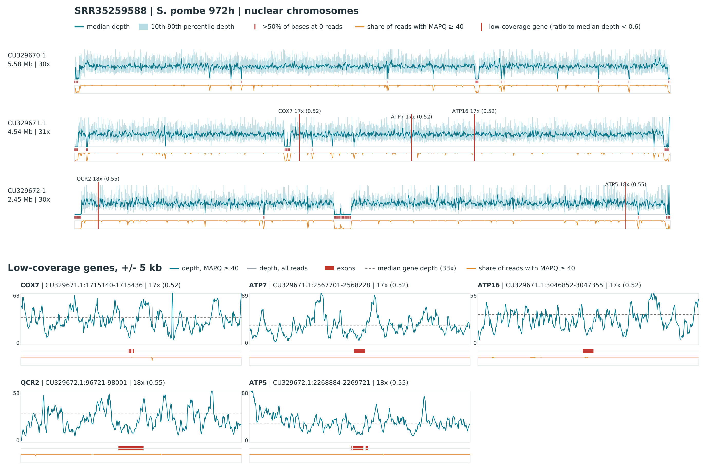

# Nuclear Coverage Map

`nuclear_coverage_map.py` draws a whole-genome read-coverage map from a BAM file as one SVG: every chromosome is drawn
end to end as its own panel. It is a fast visual check of library and mapping quality.

Optionally, it marks genes of interest from a BED file. It flags the ones with low coverage and draws a
base-resolution zoom panel for each one. The zoom shows whether a low gene is a real local dip, part of a low region,
a mapping-quality problem, or just ordinary unevenness of short-read coverage.

**What it shows:**
- **Even coverage:** a flat blue line near the chromosome's typical depth.
- **Problems:** coverage sags, uneven libraries, aneuploid or missing chromosomes, mapping artifacts.
- **Mapping quality:** an orange line that stays at the top where reads map confidently and dips in repeats.
- **Low-coverage genes (with `--genes`):** marked on the chromosomes and zoomed below.

## Example



This is *Schizosaccharomyces pombe* 972h, public WGS run SRR35259588, mapped to the 972h reference. It was run with
the respiratory-chain (OXPHOS) nuclear genes as `--genes` ([`example_genes.bed`](example_genes.bed)):

```bash
python3 nuclear_coverage_map.py SRR35259588.bam example_map.svg example_map.tsv \
    "SRR35259588 | S. pombe 972h | nuclear chromosomes" --genes example_genes.bed
```

**How to read it:**
- **Chromosomes:** all three sit at ~30× with a flat blue line. The mapping-quality line stays at the top except at
  short repeats and the centromeres, where coverage also dips. That is good data.
- **Flagged genes:** five genes fall below the 20× flag at ~0.5 of the median gene depth (33×).
- **Zoom panels:** around each flagged gene, the depth goes up and down the same way across the whole 10 kb, and the
  gene sits in one of those ordinary troughs. The grey (all reads) and blue (MAPQ ≥ 40) lines overlap, and the
  orange line is flat, so no reads were lost to poor mapping. The low genes are normal unevenness of a 30× library,
  not a deletion or an artifact.

The full-resolution output is [`example_map.svg`](example_map.svg).

## What the map shows

**Chromosome panels**

| Element | Meaning |
|---|---|
| Blue line | Median read depth in each screen column (~1,050 columns per chromosome) |
| Pale band | 10th–90th percentile of depth in that column |
| Red tick | Column where more than half the bases have no reads |
| Orange line (strip under each chromosome) | Share of reads with mapping quality ≥ `--min-mapq`; top of the strip = 100% |
| Red vertical line + label | A marked gene: its depth and its ratio to the median gene depth |
| Number under the chromosome name | Its typical (median) depth; each panel has its own y scale |

**Zoom panels (one per marked gene)**

| Element | Meaning |
|---|---|
| Blue line | Depth from reads with mapping quality ≥ `--min-mapq` |
| Grey line | Depth from all reads; a gap between grey and blue = reads lost to low mapping quality |
| Red boxes | The gene's pieces from the BED (e.g. coding exons) |
| Dashed line | Median gene depth |
| Orange line | Share of reads with mapping quality ≥ `--min-mapq` |

## Requirements

- Python 3 (standard library only)
- `samtools` on your `PATH`
- A coordinate-sorted, indexed BAM (`samtools index sample.bam`)

## Usage

```bash
python3 nuclear_coverage_map.py sample.bam sample.svg sample.tsv "Sample | species | strain" [options]
```

| Option | Default | Meaning |
|---|---|---|
| `--skip CONTIG` | none | Leave out one sequence, e.g. the mitochondrial contig of a whole-genome BAM, so its very high depth does not dominate |
| `--genes BED` | none | Genes to measure: `contig, start, end, name`; lines with the same name form one gene (e.g. exons). Gene depth = median depth over its bases |
| `--flag-depth` | `20` | Mark a gene when its depth is below this ... |
| `--flag-ratio` | `0.6` | ... and below this fraction of the median gene depth |
| `--mark-all` | off | Mark every gene in the BED instead of only the low ones |
| `--zoom-flank` | `5000` | bp shown on each side of a marked gene; `0` = no zoom panels |
| `--min-mapq` | `40` | Minimum mapping quality counted (also the threshold of the orange line) |
| `--min-baseq` | `0` | Minimum base quality counted; 0 = every base a read covers |
| `--no-duplicates` | off | Leave out duplicate-marked reads. By default they are counted: at high depth most "duplicates" are independent molecules that start at the same position by chance |
| `--min-length` | `100000` | Shortest sequence drawn (bp) |

**Outputs:**
- `sample.svg`: the map.
- `sample.tsv`: the numbers behind every column (`chrom, start, end, p10, median, p90, zero_fraction,
  mapq_share`), useful for scoring maps automatically. For example, count the fraction of columns within 0.5–2× of
  the median depth as an evenness score.
- Standard output: one summary row per chromosome (length, median depth, y-scale maximum, number of mostly uncovered
  columns). With `--genes`, also one row per gene (depth, ratio to the median gene depth, marked yes / no).

## Running many samples on a SLURM cluster

```bash
#!/bin/bash
#SBATCH --job-name=coverage_maps
#SBATCH --array=1-100%20
#SBATCH --mem=8G
#SBATCH --time=04:00:00
# manifest.tsv (tab-separated, no header): sample  bam_path  title  contig_to_skip  genes_bed
set -euo pipefail
module load samtools
IFS=$'\t' read -r SAMPLE BAM TITLE SKIP GENES < <(sed -n "${SLURM_ARRAY_TASK_ID}p" manifest.tsv)
mkdir -p svg tsv
python3 nuclear_coverage_map.py "$BAM" "svg/${SAMPLE}.svg" "tsv/${SAMPLE}.tsv" "$TITLE" \
    --skip "$SKIP" --genes "$GENES" > "tsv/${SAMPLE}.summary.tsv"
```

## Notes

- **Run time:** about 30 s for a 12 Mb genome at 30×; longer for large or deep genomes, since every base is read.
  Zoom panels add a few seconds per marked gene.
- **Gene depth** uses the same settings as the map (mapping quality, base quality, duplicates), so a gene's number
  and the blue line describe the same reads.
- **Fragmented assemblies:** for references with thousands of short contigs, chromosome panels are not useful.
  Summarise depth in fixed windows instead.
